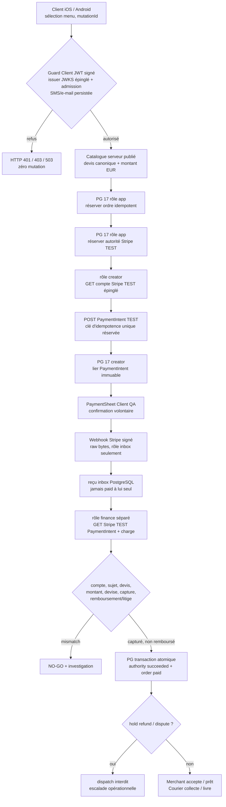

# 📌 DelishAfrica® — Architecture épinglable : commerce / Stripe TEST / PostgreSQL 17 (QA isolée)

**Date :** 12 octobre 2026
**Statut :** candidats certifiés en CI synthétique, **NON ACTIVÉS / NO-GO commercial et Stores**
**Branche :** `feat/stripe-test-reconcile-pg-qa-20261012`, [PR #36 DRAFT](https://github.com/adminluxe/DelishAfrica/pull/36), superposée à [PR #35 DRAFT](https://github.com/adminluxe/DelishAfrica/pull/35).
**Ancêtre de référence :** webhook PG certifié `640df62bc9ed6bdfbf3de593b08e99b6faae72b4`.
**Monorepo runtime historique :** `/opt/delishafrica/monorepo`, **non modifié dans cette intervention**. `/opt/delishafrica/compose` est historique et ne doit pas servir de source des apps.
**Copie QA isolée Toshiba :** `/home/tontoncestcarre/work/DA_STRIPE_RECON_QA_20261012`.

## Graphe logique — NE PAS confondre avec architecture déployée



Ce graphe est la **cible fonctionnelle**, pas une assertion que la chaîne HTTPS réelle est raccordée. Aujourd'hui, les quatre opérations PG/réconciliation du milieu existent dans le laboratoire ; les routes publiques et les rôles natifs restent déconnectés.

## Frontières d'autorité

| Acteur | Autorité permise | Autorité refusée |
| --- | --- | --- |
| Client mobile | envoyer panier SKU/quantité et mutation idempotente | choisir prix, statut paid, rôle ou `client_subject` |
| Guard Client | vérifier JWT cryptographiquement + email/SMS autorisés en transaction | admettre sur simple entête ou profil local |
| Catalog server | chiffrer devis à partir des données publiées | accepter montant du smartphone |
| PostgreSQL app | réserver commande, autorité et clé unique | écrire `paid`, `provider_verified` |
| Receiver webhook | persister événement HMAC signé, anti-replay | écrire `paid` ou confirmer un montant |
| Stripe intent creator | vérifier compte TEST puis créer/lier **une** PI | utiliser une clé `sk_live_`, confirmer/capturer sans le Client |
| Financial reconciler | relire PI/charge Stripe, écrire preuve transactionnelle | livrer si remboursement/litige/écart |
| Merchant / Courier | traiter uniquement commandes payées et attribuées | contourner l'ownership, auto-pickup, auto-livraison |
| Ops | diagnostic, blocage fraude, rapprochement humain | forcer `paid` par un simple champ HTTP |

## Implémentation dans la PR #36

- Migration `services/api-nest/migrations/client-commerce/20261012_004_stripe_test_financial_reconciliation_qa_only.sql` : rôles creator/finance QA, fonctions réservées, reçu financier append-only, hold et garde de dispatch.
- `services/api-nest/src/client-commerce/stripe-test-intent-create.pg-qa.adapter.ts` : réservations SQL préalables, `GET /v1/account`, POST TEST à clé réutilisée, bind PG, blocage au-delà de 18 h sans PI durable.
- `services/api-nest/src/client-commerce/stripe-test-financial-reconcile.pg-qa.adapter.ts` : `GET /v1/account`, `GET /v1/payment_intents/:id?expand[]=latest_charge`, contrôles capture/ownership et transaction atomique.
- Tests de ces composants sur **PostgreSQL 17 réel dans Docker `--network none`**, avec le fournisseur HTTPS intégralement simulé. Aucun secret réel, aucun conteneur persistant ni port exposé.
- `services/api-nest/src/client-commerce/client-commerce-canonical-quote.pg-qa.adapter.ts` : pare-feu du devis. Accepte seulement partenaire, SKU, quantité ; consulte le vrai `CatalogOrderPolicyService` côté serveur ; recalcule prix EUR, frais, disponibilité et empreintes. Le JSON du mobile ne fournit jamais le montant à Stripe.
- `services/api-nest/src/client-commerce/native-client-checkout.qa.controller.ts` : prototype HTTP NestJS **isolé non déployé** sous `/qa-isolated/client-commerce/payments/create-intent`, avec JWT Client RSA et admission durable, contrôle explicite QA non-production et port provider simulé dans les tests. Cette route n'est PAS le vrai `/payments/create-intent`.
- `ops/stripe/DA_STRIPE_TEST_OFFICIAL_PREFLIGHT_V1.sh` : vérification préliminaire en lecture seule des conditions TEST, sans exposition des secrets. Accès fournisseur GET uniquement sous deux garde-fous indépendants, désactivé par défaut.
- `apps/client/utils/daCheckoutAttemptFence.ts` et appels expérimentaux dans `apps/client/app/checkout-preflight.tsx` : préservation du même `clientMutationId` **avant** création d'intention ; état SecureStore immuable du Client par compte et empreinte de panier ; `sheet_open` bloque toute reprise de paiement ambiguë. Relecture de l'ordre payé identique exigée pour libérer le verrou. Double garde QA : `EXPO_PUBLIC_DA_CHECKOUT_FENCE_QA=YES` **et** `NODE_ENV` non-production. Ce n'est ni une preuve bancaire ni une solution de réconciliation multi-appareil. Aucun binaire Store modifié.
- CI commune API + Client/Merchant/Courier et preuve HTTP sur le même SHA `a2783bdcd569ee577a1aac424f74286057a9498d` : [#38296555360](https://github.com/adminluxe/DelishAfrica/actions/runs/38296555360) SUCCESS ; SQL PG17 [#38296555438](https://github.com/adminluxe/DelishAfrica/actions/runs/38296555438) SUCCESS.
- Point d'entrée réel **NON raccordé** : `services/api-nest/src/app.module.ts` et routes existantes `orders/create`, `payments/create-intent`, `stripe/webhook`. La séparation est intentionnelle tant que le parcours natif E2E et Stripe TEST officiel n'ont pas été certifiés.

## Chaînage du contrat commercial Client QA — deux POST, zéro route de production

**Certifié dans le laboratoire le 12 octobre 2026**, code SHA `4d3135d516889e3087b45a63d77ba02dd6d674c0` (NestJS HTTP + PG17 CI **SUCCESS**) puis code SHA `9dfefa35c751e252d636c988641ed570221120d1` (12 tests Client + les trois applications + PG17, deux CI **SUCCESS**).

```text
Client QA / session OIDC authentifiée
    |
    | SecureStore: reserve:<nonce> + mutation stable + panier local
    v
POST /qa-isolated/client-commerce/orders/create
    |
    | NativeClientNestCommerceGuard JWT RSA + admission e-mail/SMS
    | catalogue publié -> devis serveur
    | da_qa_service_reserve_order() -> UUID PostgreSQL immuable
    v
orderId:UUID + canonicalQuoteFingerprint + canonicalCartFingerprint
    |
    | SecureStore bindServerOrderId() une seule fois
    v
POST /qa-isolated/client-commerce/payments/create-intent
    |
    | MÊME Client / mutation / UUID / devis / panier serveur
    | nouvelle lecture de réservation PostgreSQL avant provider
    | créateur TEST SQL-first, HMAC de la clé d'idempotence
    v
PaymentIntent TEST + clientSecret
    |
    | SecureStore markIntent() AVANT PaymentSheet
    | confirmation volontaire seulement si future UI QA validée
    v
Webhook HMAC -> Inbox PG -> Finance GET Stripe + charge -> paid
    |
    | UNQUEMENT après preuve bancaire durable, pas sur callback UI
    v
Merchant -> Courier (NON encore raccordé)
```

Le contrôleur `services/api-nest/src/client-commerce/native-client-checkout.qa.controller.ts` expose les deux POST **uniquement dans un module Nest éphémère de test** ; aucune route QA n'est enregistrée dans `services/api-nest/src/app.module.ts`. Port de catalogue réel `QaCanonicalClientQuoteAdapter`, réservation SQL stricte `QaClientCommercePgAdapter`, créateur TEST `QaStripeTestIntentCreator` ; en test HTTP, les ports PostgreSQL/Stripe sont simulés, tandis que les adaptateurs SQL/Stripe passent leur suite distincte sur PG17 déconnecté.

La classe Client `apps/client/utils/daCanonicalCheckout.qa.ts` est **non importée dans les écrans Expo** : elle n'est pas un correctif déployé. Le verrou `apps/client/utils/daCheckoutAttemptFence.ts` sait désormais remplacer une fois la référence locale par le UUID **avant** PI, puis interdit les rebind et les doubles tentatives incertaines. Les écrans runtime continuent d'appeler les anciens endpoints ; ni PaymentSheet réelle, ni réception `paid`, ni remise au marchand ne sont raccordées.

```text
APP_MODULE PUBLIC ROUTES               UNCHANGED
QA HTTP module                         isolated tests ONLY
Test account / real Stripe access      NOT_CONFIGURED locally
Test PG17                              ephemeral network-none Docker
Merchant/Courier paid gate             NOT_WIRED
G0–G7                                  NO-GO
GitHub PR #35 / #36                    DRAFT / NO MERGE
```

**Attention à l'idempotence multi-appareils :** le verrou SecureStore est local à un terminal. Le serveur doit aussi empêcher des commandes réellement doublées à partir de mutations différentes ou de sessions parallèles dans un contrat produit explicitement défini avant toute activation publique. Le stock et les lignes d'ordre doivent être persistés pour un vrai fulfill Merchant ; les tables de réserve actuelles lient montants/empreintes mais ne sont pas encore le modèle complet commercial.

## Architecture épinglée — preuve financière Client après PaymentSheet (13/10/2026)

**Jalon code a0dbcc6bb1224db192fc9d918f38af946d2cad8b ; doubles CI SUCCESS :**
[API + 3 apps #38317389130](https://github.com/adminluxe/DelishAfrica/actions/runs/38317389130) · [PostgreSQL17 #38317389082](https://github.com/adminluxe/DelishAfrica/actions/runs/38317389082).

~~~text
Client QA (aucun écran Expo n'importe cette séquence)
    |
    | SecureStore: ordre UUID + mutation + PaymentIntent du test
    | Token RSA/JWT réel Client avec admission durable e-mail/SMS
    v
POST /qa-isolated/client-commerce/orders/status [HTTP NEST QA UNIQUEMENT]
    |
    | Contrôle rôle, issuer, subject, ordre UUID et mutation
    v
QaClientOwnedOrderReceiptReader [PORT PG QA EN LECTURE SEULE]
    |
    v
da_qa_client_read_owned_order(order, issuer, subject)
    |
    +-- pending / pas de reçu --> awaiting_payment, dispatch=false
    |
    +-- capture vérifiée + reçu immuable + aucun hold
    |                           --> paid, dispatch=true
    |
    +-- remboursement ou litige --> financial_hold, dispatch=false
    |
    +-- divergence d'état financier --> needs_review, dispatch=false
    |
    v
Client QA : SEUL 'paid' + même PI permet de vider le verrou local
    |
    +-- Status en attente/hold/erreur --> verrou intact, aucune nouvelle PI
    |
    v
Merchant et Courier doivent revérifier l'éligibilité au dispatch
    [NON RACCORDÉS, NON DÉPLOYÉS]
~~~

**Séparation des responsabilités :** l'API Client lit l'autorité financière durable, elle ne la crée pas. Le webhook Stripe signé entre en inbox et le reconciler serveur indépendant vérifie Stripe TEST via la charge réellement capturée, avant tout commit financier SQL. Le Client et ses événements PaymentSheet ne peuvent jamais imposer paid. La migration 005 n'est accessible qu'au rôle QA de lecture fonctionnelle, sans SELECT/DML direct sur les tables. Les tests Nest réels utilisent des ports PostgreSQL/Stripe simulés ; seule la CI PostgreSQL est exécutée contre une vraie base **déconnectée**.

**Frontière de confiance encore incomplète :** les arguments issuer et subject de la fonction SQL ne constituent pas une preuve d'identité autonome au niveau de PostgreSQL. Ils doivent être fournis exclusivement par l'admission vérifiée du serveur ; une compromission du compte DB applicatif imposerait une protection complémentaire avant production. Renforcer SECURITY DEFINER (propriétaire NOLOGIN non-superuser), les rôles, la propagation des claims signés et la révocation des permissions dangereuses avant tout rapprochement production.

**GEL :** pas de modification des routes de production ; pas d'intégration dans les binaires Client/Merchant/Courier ; pas de Stripe réel TEST ni LIVE ; pas de migration VPS ni de changement Keycloak ; pas de G0–G7, fusion ou Store sans certification et feu vert du propriétaire.

## Architecture QA F4 — panier marchand immuable avant paiement (13/10/2026)

**Source du code :** commit `e40b0ecb49d29f64c6abe4db68507de741b7427c`. [CI SQL PostgreSQL17 #38319913618](https://github.com/adminluxe/DelishAfrica/actions/runs/38319913618) et [CI API + 3 apps #38319916985](https://github.com/adminluxe/DelishAfrica/actions/runs/38319916985) : **SUCCESS sur le même SHA**.

```text
Client JWT Client admis (source de vérité de l'identité)
      |
      | Seuls merchantSlug + SKU + quantité sont fournis par le mobile
      v
CatalogOrderPolicyService (catalogue publié SERVEUR)
      |
      | Nom, catégorie, quantité, prix unitaire, montant ligne,
      | sous-total, livraison, devis/fingerprint canoniques
      v
QaCanonicalOrderSnapshotPgAdapter (QA seulement)
      | TRANSACTION PostgreSQL BEGIN
      |    da_qa_service_reserve_order() : UUID canonique
      |    da_qa_service_store_order_snapshot() : panier immutable
      | COMMIT ou ROLLBACK intégral en cas d'échec
      v
da_client_commerce_order_snapshot_qa (migration 006 déconnectée)
      | App ne détient que EXECUTE sur fonction snapshot
      | AUCUN SELECT/UPDATE direct ; panier en lecture immuable
      v
BEFORE INSERT payment authority : refuse snapshot manquant
      |
      | Stripe TEST synthétique : vraie capture/reçu financier PG17
      v
da_qa_commerce_order_dispatch_eligible()
      | Exige panier + reçu capturé + paid vérifié + pas de refund/hold
      v
Merchant/Courier : aucune route publique raccordée à ce jour
```

**Propriété majeure :** un paiement ne doit jamais pouvoir être créé pour un UUID sans panier conservé. Le trigger 006 coupe les réservations historiques dépourvues de snapshot dès que cette migration est appliquée ; c'est voulu dans le laboratoire, mais **interdit de la promouvoir telle quelle sur les bases VPS existantes** sans stratégie de compatibilité et migration contrôlée. Le seul nouvel adaptateur transactionnel est encore expérimental et non injecté dans AppModule.

**Limites de confiance :** le snapshot SQL valide arithmétique, valeurs et concordance avec le devis de l'ordre, mais **ne vérifie pas à lui seul que les noms/prix proviennent du catalogue publié** : ce rôle appartient à `CatalogOrderPolicyService` et au contexte serveur approuvé. Les `SECURITY DEFINER` et arguments issuer/subject exigent un propriétaire dédié non-superuser, une séparation IAM et une identité liée aux claims vérifiés avant une production. Toute émission de mission Merchant/Courier requiert une nouvelle vérification transactionnelle juste avant dispatch/accept/pickup, pour empêcher la livraison après un hold tardif.

**Test Node réellement connecté à PostgreSQL : CERTIFIÉ EN QA.** Le commit exact `2b54913be6310fa399f0c3ea676b73e40d911b81` passe les deux pipelines [PostgreSQL 17 #38320332214](https://github.com/adminluxe/DelishAfrica/actions/runs/38320332214) **SUCCESS** et [API + 3 apps #38320332362](https://github.com/adminluxe/DelishAfrica/actions/runs/38320332362) **SUCCESS**. Le fichier `services/api-nest/test/client-order-snapshot.pg-qa.integration.cjs` exerce l'adaptateur transactionnel contre deux PgPools applicatifs en véritable PostgreSQL 17 sans réseau : **8 courses simultanées → 1 UUID, 1 panier, 1 autorité de paiement**, compatibilité legacy sans panier refusée, panne avant COMMIT → ROLLBACK et aucune commande orpheline, SELECT/UPDATE directs refusés au rôle applicatif. Cette preuve complète les tests SQL 006; elle n'implique ni Stripe TEST officiel ni le raccordement Merchant/Courier. **Stripe officiel TEST non connecté, routes publiques non migrées, G0–G7 NO-GO, PR #35/#36 DRAFT, LIVE gelé.**

## Architecture épinglée — flux Merchant / Dispatch / Courier QA 007 (13/10/2026)

**Preuves :** migration SQL + contrôleur QA code `d3a0d48a317f3c867e64d229e752da23c9e59a33`, [CI PG17 #38322184915](https://github.com/adminluxe/DelishAfrica/actions/runs/38322184915) et [CI API/3 apps #38322184929](https://github.com/adminluxe/DelishAfrica/actions/runs/38322184929) **SUCCESS**. Adaptateur Node réel + trois pools PG `3ebcdcbd2db4a753beffc8b9e3c1d8c67f1903ee`, [CI PG17 #38322468685](https://github.com/adminluxe/DelishAfrica/actions/runs/38322468685) et [CI API/3 apps #38322468143](https://github.com/adminluxe/DelishAfrica/actions/runs/38322468143) **SUCCESS**.

```text
Client signé et admis
  -> catalogue publié serveur
  -> UUID + devis + snapshot immuable PostgreSQL 006
  -> Stripe TEST *synthétique* ; capture + reçu financier + NO HOLD
       |
       v
Merchant QA HTTP (OrdersAuthGuard + membership contractuel actif)
  -> Pool da_qa_merchant_commerce_app
  -> SQL da_qa_merchant_visible_paid_orders() : inbox payé uniquement
  -> SQL da_qa_merchant_transition() : accepted -> ready
       |
       v
Dispatch interne (courier roster serveur, JAMAIS HTTP du téléphone)
  -> Pool da_qa_dispatch_commerce_app
  -> SQL da_qa_dispatch_assign_offer() : un seul livreur assigné
       |
       v
Courier QA HTTP (OrdersAuthGuard + registre actif)
  -> Pool da_qa_courier_commerce_app
  -> SQL da_qa_courier_assigned_offers() : assignee uniquement
  -> SQL da_qa_courier_transition() : offered -> accepted
                                             -> picked_up -> delivered
       |
       +-- à CHAQUE transition : snapshot + capture + reçu + absence hold
       +-- hold refund/dispute déjà commité -> blocage, pas de pickup
```

**Frontières de confiance :** le vrai `OrdersAuthGuard` est exécuté en HTTP de laboratoire, mais son `AuthService` résout une identité simulée pendant ces tests. Les porteurs d'identité marchand et livreur réels, le ledger de membership et le registre Courier restent à intégrer. Les fonctions SQL en SECURITY DEFINER n'authentifient **pas** de façon autonome un issuer/subject ou un merchantSlug transmis par la couche applicative. Les rôles de base sont séparés, mais ce point exige un lien serveur↔base attesté ainsi qu'un propriétaire fonction NOLOGIN avant toute promotion.

**Course financière à traiter :** les tests confirment le blocage si le refund est déjà commité avant `picked_up`, pas la sérialisation complète si hold et transition se produisent simultanément. La prévention transactionnelle doit être renforcée/testée pour éviter un TOCTOU de livraison. Adresse de livraison, géolocalisation/ETA, réassignation, vraies notifications et Ops n'appartiennent pas encore au modèle 007.

**GEL TOTAL :** SQL 007 et routes QA **non installés sur VPS**, aucun module enregistré dans `AppModule`, aucun Stripe officiel TEST/LIVE, aucun EAS, aucun G0–G7, aucun merge des PR #35/#36, aucun Store. Ces schémas/sources sont des candidats QA, non des permissions de mise en production.

## Architecture QA F4C — verrou financier et livraison atomiquement ordonnés (13/10/2026)

**Code :** `dde5b460d0c547d59c3dcafa907149b178d512d2`. [CI PostgreSQL17 réelle #38323181256](https://github.com/adminluxe/DelishAfrica/actions/runs/38323181256) **SUCCESS** ; [CI API + 3 apps #38323181287](https://github.com/adminluxe/DelishAfrica/actions/runs/38323181287) **SUCCESS**.

```text
                 UNE COMMANDE UUID / ORDER ROW
                         PostgreSQL17
                              |
                 Verrou unique FOR UPDATE
                   ordre commande AVANT
                ordre autorité de paiement
                     /              \
                    /                \
        DA finance TEST QA      Courier/Dispatch QA
          record_hold()           transition()
          refund/dispute       accepted/picked_up/
                               delivered (ou offer)
                    \                /
                     \              /
              Une seule progression validée
              à la fois; l'autre doit attendre
                              |
        +---------------------+----------------------+
        |                                            |
   hold COMMIT premier                      pickup COMMIT premier
        |                                            |
   pickup refusé                           hold attend puis s'inscrit
   état reste accepted                             |
                                            delivered ensuite refusé
```

**Migration QA 008 :** `CREATE OR REPLACE FUNCTION da_qa_finance_record_hold` ne change ni signature ni permissions de sa fonction 004 ; elle verrouille l'ordre et l'autorité dans le même ordre que les transitions 007, contrôle à nouveau le reçu financier, puis insère le hold append-only avec idempotence. Aucune table ni route publique modifiée. Les rôles restent séparés et le test réel utilise deux PgPools transactionnels et `pg_stat_activity` pour constater les attentes `wait_event_type=Lock`.

**Garantie exacte :** la présence d'un hold déjà COMMIT interdit la progression, même si une opération Courier était simultanément en attente. Si l'enlèvement avait légalement COMMIT avant le remboursement, il ne peut être « dé-enlevé » ; la retenue empêche toute progression ultérieure vers `delivered`. L'exécution des litiges et retours physiques nécessite un processus Ops/assistance additionnel.

**Frontières à corriger avant promotion :** fonctions SECURITY DEFINER avec propriétaire de laboratoire, issuer/subject/slug fournis par service applicatif sans attestation cryptographique dans la DB ; vrai JWT Merchant/Courier et membres KYB/registre actifs non intégrés au backend cible ; transports Expo et notifications non branchés ; jamais de connexion officielle Stripe TEST ni G0–G7 validés. Ne jamais appliquer 001–008 aux bases VPS en l'état.

## Architecture QA F4D — FINANCE WALLET Merchant & Courier, journal équilibré 009 (13/10/2026)

**Dernier code certifié QA :** `9801dc0801361e80c28a67d8478c10a462909a23` ([PG17 #38324552260](https://github.com/adminluxe/DelishAfrica/actions/runs/38324552260) et [API/apps #38324552388](https://github.com/adminluxe/DelishAfrica/actions/runs/38324552388) SUCCESS). Routes QA ajoutées en `1af2f65e116d427be63585aefd6f000dcf34db09` ([PG #38324760411](https://github.com/adminluxe/DelishAfrica/actions/runs/38324760411) et [HTTP + 3 apps #38324760436](https://github.com/adminluxe/DelishAfrica/actions/runs/38324760436) SUCCESS). Garde d'isolation en `79964cee22cb39a60b1588912e2d2199dd5b17c1`, CI **SUCCESS** [PostgreSQL17 #38324993520](https://github.com/adminluxe/DelishAfrica/actions/runs/38324993520) et [API + 3 apps #38324993516](https://github.com/adminluxe/DelishAfrica/actions/runs/38324993516).

```text
  Client commande [QA: JWT/ledger simulés en HTTP]
              |
  devis serveur + panier 006 immuable
              |
  paiement Stripe TEST synthétique VÉRIFIÉ et capturé (004)
              |
              v
       FINANCE RECONCILER RÔLE QA
       (pas d'autorisation mobile)
              |
       order FOR UPDATE + receipt exact + policy DB
              |
       009 da_qa_wallet_accrue_verified_capture(UUID)
         - montant exact, idempotent x8
         - policy immuable QA_FIXTURE_EUR_V1, EUR SEULEMENT
         - signed journal immutable 4 lignes, total = ZERO
              |
              +-- Clearing interne  -26,90€ (PAS un compte bancaire)
              +-- Merchant earned    +18,40€ (TEST)
              +-- Courier reserved   +03,90€ (TEST)
              +-- Platform retained  +04,60€ (TEST)
              |
      2 projections de droits calculées À LA LECTURE
              |
         +----+-------------------------------------+
         |                                          |
   Merchant membership                       Courier roster
   issuer/subject + KYB+contrat              issuer/subject actif
   [contrôle app QA]                          [contrôle app QA]
         |                                          |
   /qa-isolated/wallet/merchant/summary    /qa-isolated/wallet/courier/summary
         |                                          |
   capturé -> pending                       pas assigné -> aucun droit
   ready -> available                       offert -> pending
   refund -> held                           delivered -> available
                                             refund -> held
         |                                          |
         +-----------------+------------------------+
                           |
                   withdrawable = 0
                   payoutEnabled = false
                   NO BANK / NO STRIPE PAYOUT
```

Les tables `da_qa_wallet_policy`, `da_qa_wallet_allocation`, `da_qa_wallet_posting` sont append-only et invisibles aux rôles applicatifs ; une fonction finance seule écrit. Les rôles `da_qa_merchant_commerce_app` et `da_qa_courier_commerce_app` ne peuvent appeler que leurs projections respectives. Les présentations HTTP Nest sont **strictement en lecture seule, protégées par OrdersAuthGuard et désactivées en production** ; `Cache-Control: private, no-store`, champs HTTP limités. `AppModule` ne référence pas ces composants.

**Attention aux limites de confiance :** les projections SQL de ce laboratoire acceptent encore le `merchantSlug` ou `issuer/subject` passés par le service. Le rôle PostgreSQL est partagé par les requêtes du produit : il n'existe pas de liaison cryptographique **indépendante côté DB** avec la session du commerçant/livreur. En cas de compromission du service, des lectures cross-tenant restent théoriquement possibles. Il s'agit donc de **candidats QA, et pas de services bancaires sécurisés en production**. Les tests HTTP utilisent le vrai contrôleur/OrdersAuthGuard mais un `AuthService` synthétique ; les vrais JWT/SMS/KYB/rosters ne sont pas certifiés de bout en bout.

**Architecture internationale future :** ledger versionné par contrat/territoire/devise dès la réservation du panier ; transactions unitaires en *minor units* strictement isolées par devise ; répartition TVA/taxes, commission, pourboires, chargebacks, remboursements partiels et solde négatif ; PSP marketplaces/Connect et retenues KYC/KYB ; preuve d'éligibilité disponible / réellement retirable / réellement viré et rapprochement des transferts. Pas de conversion FX implicite, jamais de valeur décorative présentée comme argent acquis.

**Principes UI premium :** réaction instantanée à chaque événement financier **confirmé par API**, animation de mouvement associée à son UUID et à la commande, preuve visible de commission/frais, quatre catégories *en attente / éligible / bloqué / viré*, filtres par période et devise, avis intelligibles sur litiges, état offline clairement « dernière synchronisation » sans solde fictif. Pas d'animation de montant optimiste après action du téléphone.

**NO-GO absolu avant intégration :** pas de Stripe TEST officiel, pas de payout, pas d'inscription dans AppModule ou apps Expo, pas de migration VPS/PG prod, pas de fusion ni Store. Valider préalablement scope cryptographique et IAM SQL, PSP TEST, conformité territoriale et G0–G7 des trois applications.

## Interventions interdites avant signature d'un passport G0–G7

```
main                         PROTÉGÉ
PR #35 / PR #36              DRAFT, sans merge
VPS / Docker / PG prod       aucune migration 001-004 en production
Cloudflare / Keycloak        aucun changement
Apple / Android / EAS        aucune build soumise ni publiée
Stripe LIVE                  interdit
Stripe TEST officiel         désactivé, attente environnement QA approuvé
```

## Critères de promotion vers vraie route commerciale

1. **CI verte sur le SHA exact**, avec preuves de rôles, anti-replay, multi-pools, coupures réseau/SQL, remboursement et hold.
2. **Environnement Stripe TEST officiel isolé**, `sk_test_`, `pk_test_`, `whsec_` distincts dans coffre de secrets, compte `acct_` épinglé, aucune clé dans Git/logs.
3. Guard Client réellement branché au JWT signé et à l'admission Keycloak/SMS/e-mail persistée ; récupération fiable de ses permissions et révocation.
4. API `/orders/create`, `/payments/create-intent`, webhook, `/orders/confirm` avec devis serveur, idempotence SQL, scénarios paiement refusé/annulé/3DS, sans retomber sur la démo.
5. Merchant & Courier : ownership, proposition/acceptation, aucun pickup/delivered automatique, livraison interdite si non payé/hold.
6. Tests **G0–G7** sur Client/Merchant/Courier iOS et Android, captures, SHA et numéros de builds ; validation explicite de Tonton avant merge/store.
7. Correction indépendante des propriétaires `SECURITY DEFINER`/rôles avant toute migration hors Docker QA : les fonctions du laboratoire appartiennent à l'administrateur du conteneur et ne sont PAS des privilèges production.

**État read-only VPS après retour SSH (12/10/2026) :** API 3010/3011 HTTP 200, Keycloak/PG/API actifs ; `/opt/delishafrica/monorepo` sur `innovation/confluence-trust-current-20261001` à `e504c04`, 15 fichiers suivis modifiés ; disque 88 % utilisé, 25 Go libres. Un ancien conteneur utilise une clé au format Stripe TEST, mais la QA officielle isolée n'est pas configurée/activée et aucun secret n'a été affiché ni utilisé. Aucune opération live. Détails dans `docs/DA_STRIPE_TEST_RECONCILIATION_QA_2026-10-12.md`.

**Décision :** ce document complète les anciens pins sans prétendre les modifier sur le VPS. État = **pré-production isolée, provider TEST réel et routes commerciales non certifiés**.

---

## Architecture addendum F4E — frontière du compte financier (13 octobre 2026)

**Base F4D :** `cd0ba578401d087f9f42c4303e5501704d6bbf94`, CI [PG17 38325285489](https://github.com/adminluxe/DelishAfrica/actions/runs/38325285489) / [API et apps 38325285497](https://github.com/adminluxe/DelishAfrica/actions/runs/38325285497) SUCCESS.

**Candidat F4E :** branche `feat/f4e-wallet-scope-isolation-qa-20261013`, [PR #37 DRAFT](https://github.com/adminluxe/DelishAfrica/pull/37) distincte de #36 ; tests techniques de la migration 010 et du gate OIDC passés sur le **même SHA de code** `f97567f3e7c89ae5f80e33261cd2da6a2045dfb8` : [PG17 38327215358](https://github.com/adminluxe/DelishAfrica/actions/runs/38327215358) SUCCESS et [API + trois apps 38327215429](https://github.com/adminluxe/DelishAfrica/actions/runs/38327215429) SUCCESS. Les changements documentaires ultérieurs n'emportent pas automatiquement une nouvelle certification du HEAD.

```text
Keycloak OIDC (réel) ----------------------- NON RELIÉ À L'ATTESTOR 010
  | RSA/JWKS, issuer, aud, azp, rôle          (F4E renforce le gate claim)
  v
NestJS OrdersAuthGuard + contrôle de session
  | membership/contrat/KYB/roster durable    (source réelle NON intégrée F4E)
  v
ATTÉSTEUR SQL DÉDIÉ : da_qa_wallet_attestor_010
  | app login SQL / challenge lié PID + backend_start
  | scope issuer + subject + org + territoire + marchand
  | registre QA synthétique validé et durée courte
  v
Ticket SQL UUID (non forgé par app), 20 s, usage unique
  |
  v
APP MERCHANT OU COURIER : read_attested_010(ticket,limit)
  | contexte SQL = session_user + backend PID/start
  | nouvelle vérification statut juridique et roster
  | anciens EXECUTE directs par slug/issuer/subject RÉVOQUÉS
  v
NOLOGIN READ OWNER → projection historique 009 (lecture seule)
  |    merchant: capturé → pending ; ready → available ; hold → held
  |    courier: offert → pending ; delivered → available ; hold → held
  v
  withdrawableMinor = 0 / payoutEnabled = false
  Aucun Stripe officiel / aucune banque / aucun versement
```

Propriétaires SQL `da_qa_wallet_read_owner_010` et `da_qa_wallet_write_owner_010` sont **NOLOGIN NOSUPERUSER** ; l'observation `pg_stat_activity.backend_start` est limitée à une fonction du backend courant sous troisième rôle `NOLOGIN` avec capacité exceptionnelle `pg_read_all_stats`. Cette exception doit rester confinée et être revue indépendamment. Les anciens ports de mutation Merchant/Courier/Dispatch perdent EXECUTE aux rôles applicatifs après migration 010 : **réactivation interdite** tant qu'une même attestation n'est pas réalisée sur chaque écriture.

Le ledger 009 ne possède pas encore de dimension juridique/territoriale propre : F4E exige un propriétaire unique du slug Merchant et interdit la multi-affectation territoriale du même Courier. Ce comportement fail-closed n'est PAS une implémentation internationale complète. Les registres 010 sont des **fixtures synthétiques**. Un attestor compromis pourrait encore tenter d'emprunter une identité active : séparation des credentials, vérification cryptographique du port de preuve et révocation temps réel restent des gates P0 absolus.

**CI synthétique verte ≠ identité Keycloak réelle certifiée ≠ argent véritable.** Aucun changement VPS, Stripe TEST officiel ou LIVE, production SQL, EAS, Store, PR merge. Roadbook F4E détaillé : `docs/DA_PASSATION_F4E_WALLET_TENANT_ISOLATION_P0_QA_2026-10-13.md`.
