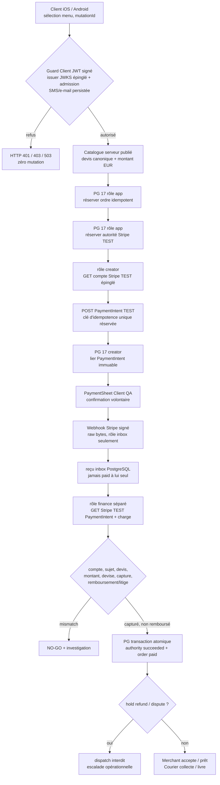

# 📌 DelishAfrica® — Architecture épinglable : commerce / Stripe TEST / PostgreSQL 17 (QA isolée)

**Date :** 12 octobre 2026
**Statut :** candidats certifiés en CI synthétique, **NON ACTIVÉS / NO-GO commercial et Stores**
**Branche :** `feat/stripe-test-reconcile-pg-qa-20261012`, [PR #36 DRAFT](https://github.com/adminluxe/DelishAfrica/pull/36), superposée à [PR #35 DRAFT](https://github.com/adminluxe/DelishAfrica/pull/35).
**Ancêtre de référence :** webhook PG certifié `640df62bc9ed6bdfbf3de593b08e99b6faae72b4`.
**Monorepo runtime historique :** `/opt/delishafrica/monorepo`, **non modifié dans cette intervention**. `/opt/delishafrica/compose` est historique et ne doit pas servir de source des apps.
**Copie QA isolée Toshiba :** `/home/tontoncestcarre/work/DA_STRIPE_RECON_QA_20261012`.

## Graphe logique — NE PAS confondre avec architecture déployée



Ce graphe est la **cible fonctionnelle**, pas une assertion que la chaîne HTTPS réelle est raccordée. Aujourd'hui, les quatre opérations PG/réconciliation du milieu existent dans le laboratoire ; les routes publiques et les rôles natifs restent déconnectés.

## Frontières d'autorité

| Acteur | Autorité permise | Autorité refusée |
| --- | --- | --- |
| Client mobile | envoyer panier SKU/quantité et mutation idempotente | choisir prix, statut paid, rôle ou `client_subject` |
| Guard Client | vérifier JWT cryptographiquement + email/SMS autorisés en transaction | admettre sur simple entête ou profil local |
| Catalog server | chiffrer devis à partir des données publiées | accepter montant du smartphone |
| PostgreSQL app | réserver commande, autorité et clé unique | écrire `paid`, `provider_verified` |
| Receiver webhook | persister événement HMAC signé, anti-replay | écrire `paid` ou confirmer un montant |
| Stripe intent creator | vérifier compte TEST puis créer/lier **une** PI | utiliser une clé `sk_live_`, confirmer/capturer sans le Client |
| Financial reconciler | relire PI/charge Stripe, écrire preuve transactionnelle | livrer si remboursement/litige/écart |
| Merchant / Courier | traiter uniquement commandes payées et attribuées | contourner l'ownership, auto-pickup, auto-livraison |
| Ops | diagnostic, blocage fraude, rapprochement humain | forcer `paid` par un simple champ HTTP |

## Implémentation dans la PR #36

- Migration `services/api-nest/migrations/client-commerce/20261012_004_stripe_test_financial_reconciliation_qa_only.sql` : rôles creator/finance QA, fonctions réservées, reçu financier append-only, hold et garde de dispatch.
- `services/api-nest/src/client-commerce/stripe-test-intent-create.pg-qa.adapter.ts` : réservations SQL préalables, `GET /v1/account`, POST TEST à clé réutilisée, bind PG, blocage au-delà de 18 h sans PI durable.
- `services/api-nest/src/client-commerce/stripe-test-financial-reconcile.pg-qa.adapter.ts` : `GET /v1/account`, `GET /v1/payment_intents/:id?expand[]=latest_charge`, contrôles capture/ownership et transaction atomique.
- Tests de ces composants sur **PostgreSQL 17 réel dans Docker `--network none`**, avec le fournisseur HTTPS intégralement simulé. Aucun secret réel, aucun conteneur persistant ni port exposé.
- `services/api-nest/src/client-commerce/client-commerce-canonical-quote.pg-qa.adapter.ts` : pare-feu du devis. Accepte seulement partenaire, SKU, quantité ; consulte le vrai `CatalogOrderPolicyService` côté serveur ; recalcule prix EUR, frais, disponibilité et empreintes. Le JSON du mobile ne fournit jamais le montant à Stripe.
- `services/api-nest/src/client-commerce/native-client-checkout.qa.controller.ts` : prototype HTTP NestJS **isolé non déployé** sous `/qa-isolated/client-commerce/payments/create-intent`, avec JWT Client RSA et admission durable, contrôle explicite QA non-production et port provider simulé dans les tests. Cette route n'est PAS le vrai `/payments/create-intent`.
- `ops/stripe/DA_STRIPE_TEST_OFFICIAL_PREFLIGHT_V1.sh` : vérification préliminaire en lecture seule des conditions TEST, sans exposition des secrets. Accès fournisseur GET uniquement sous deux garde-fous indépendants, désactivé par défaut.
- `apps/client/utils/daCheckoutAttemptFence.ts` et appels expérimentaux dans `apps/client/app/checkout-preflight.tsx` : préservation du même `clientMutationId` **avant** création d'intention ; état SecureStore immuable du Client par compte et empreinte de panier ; `sheet_open` bloque toute reprise de paiement ambiguë. Relecture de l'ordre payé identique exigée pour libérer le verrou. Double garde QA : `EXPO_PUBLIC_DA_CHECKOUT_FENCE_QA=YES` **et** `NODE_ENV` non-production. Ce n'est ni une preuve bancaire ni une solution de réconciliation multi-appareil. Aucun binaire Store modifié.
- CI commune API + Client/Merchant/Courier et preuve HTTP sur le même SHA `a2783bdcd569ee577a1aac424f74286057a9498d` : [#38296555360](https://github.com/adminluxe/DelishAfrica/actions/runs/38296555360) SUCCESS ; SQL PG17 [#38296555438](https://github.com/adminluxe/DelishAfrica/actions/runs/38296555438) SUCCESS.
- Point d'entrée réel **NON raccordé** : `services/api-nest/src/app.module.ts` et routes existantes `orders/create`, `payments/create-intent`, `stripe/webhook`. La séparation est intentionnelle tant que le parcours natif E2E et Stripe TEST officiel n'ont pas été certifiés.

## Interventions interdites avant signature d'un passport G0–G7

```
main                         PROTÉGÉ
PR #35 / PR #36              DRAFT, sans merge
VPS / Docker / PG prod       aucune migration 001-004 en production
Cloudflare / Keycloak        aucun changement
Apple / Android / EAS        aucune build soumise ni publiée
Stripe LIVE                  interdit
Stripe TEST officiel         désactivé, attente environnement QA approuvé
```

## Critères de promotion vers vraie route commerciale

1. **CI verte sur le SHA exact**, avec preuves de rôles, anti-replay, multi-pools, coupures réseau/SQL, remboursement et hold.
2. **Environnement Stripe TEST officiel isolé**, `sk_test_`, `pk_test_`, `whsec_` distincts dans coffre de secrets, compte `acct_` épinglé, aucune clé dans Git/logs.
3. Guard Client réellement branché au JWT signé et à l'admission Keycloak/SMS/e-mail persistée ; récupération fiable de ses permissions et révocation.
4. API `/orders/create`, `/payments/create-intent`, webhook, `/orders/confirm` avec devis serveur, idempotence SQL, scénarios paiement refusé/annulé/3DS, sans retomber sur la démo.
5. Merchant & Courier : ownership, proposition/acceptation, aucun pickup/delivered automatique, livraison interdite si non payé/hold.
6. Tests **G0–G7** sur Client/Merchant/Courier iOS et Android, captures, SHA et numéros de builds ; validation explicite de Tonton avant merge/store.
7. Correction indépendante des propriétaires `SECURITY DEFINER`/rôles avant toute migration hors Docker QA : les fonctions du laboratoire appartiennent à l'administrateur du conteneur et ne sont PAS des privilèges production.

**État read-only VPS après retour SSH (12/10/2026) :** API 3010/3011 HTTP 200, Keycloak/PG/API actifs ; `/opt/delishafrica/monorepo` sur `innovation/confluence-trust-current-20261001` à `e504c04`, 15 fichiers suivis modifiés ; disque 88 % utilisé, 25 Go libres. Un ancien conteneur utilise une clé au format Stripe TEST, mais la QA officielle isolée n'est pas configurée/activée et aucun secret n'a été affiché ni utilisé. Aucune opération live. Détails dans `docs/DA_STRIPE_TEST_RECONCILIATION_QA_2026-10-12.md`.

**Décision :** ce document complète les anciens pins sans prétendre les modifier sur le VPS. État = **pré-production isolée, provider TEST réel et routes commerciales non certifiés**.
